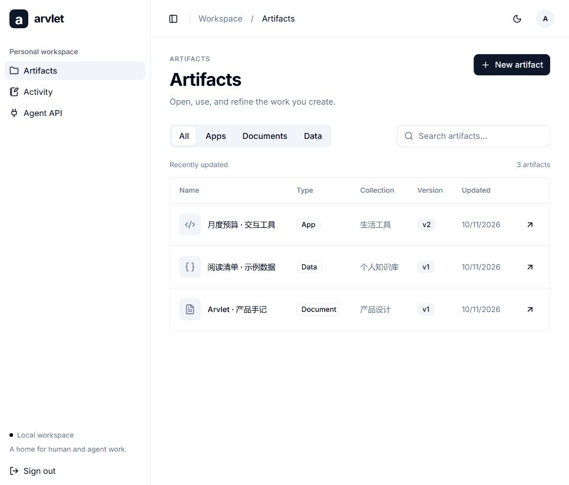

# Arvlet

An open-source workspace for AI agents to create artifacts and keep a record of
their work. Preview, edit, and use interactive apps, documents, and data in one
place, with persistent state and content history.

**Early v0.1. Single-owner, self-hosted.** Built with Go, React/TypeScript, SQLite,
Caddy, and Docker Compose. No chat interface, model server, or task workflow.



## What works

- Agents create HTML, Markdown, or JSON artifacts directly through a Bearer API.
- People preview and edit artifacts in the workbench; every save creates a version.
- HTML apps read and write their own persistent data through a restricted bridge.
- Records are append-only and can exist independently or link to an artifact.
- Retry keys prevent duplicate writes; revision checks prevent silent overwrites.
- The workbench supports searching, filtering, content history, and workspace export.
- Standalone editable links display only the artifact, with no workbench or login.
- Every artifact can be opened directly with `/?artifact=<id>` in the workbench.

External scripts, network-connected HTML apps, file uploads, React source builds,
multi-user accounts, and scoped agent tokens are not part of this release.

## Run locally

Requirements: Docker with Compose. Node.js 24 is used by the setup and demo scripts;
the deployed application has no Node or Python runtime dependency.

```sh
git clone https://github.com/arvlet/arvlet.git
cd arvlet
node scripts/setup.mjs
docker compose up -d --build
node scripts/seed.mjs
```

Open **http://localhost:3090** and sign in with `ARVLET_PASSWORD` from `.env`.
The setup script generates independent secrets and refuses to overwrite an
existing `.env`. The demo script creates three example artifacts through the public
API; retries are idempotent. After editing demo source files, use new seed keys to
create different data, rather than reusing the old keys.

Only Caddy exposes ports. The app runs without root privileges; its SQLite data
survives container replacement in the `arvlet_arvlet_data` volume.
Do not use `docker compose down -v` unless you intend to delete all persisted data.

For a public domain, set `.env`:

```dotenv
ARVLET_ORIGIN=https://arvlet.example.com
ARVLET_SITE=arvlet.example.com
ARVLET_BIND=0.0.0.0
ARVLET_HTTP_PORT=80
ARVLET_HTTPS_PORT=443
```

Point DNS to the server and allow inbound 80/443. Recreate the containers after
changing environment variables. Caddy handles HTTPS; never publish the application
port separately. Public-domain certificate issuance is environment-dependent.

## Agent API

Give a trusted agent the base URL, `ARVLET_API_KEY`, and the OpenAPI document at
`/api/openapi.json`. No custom skill is required. The key has full workspace access.
Set secrets through your agent's environment or secret store, not source files.

```sh
curl http://localhost:3090/api/v1/artifacts \
  -H "Authorization: Bearer $ARVLET_API_KEY" \
  -H "Content-Type: application/json" \
  -H "Idempotency-Key: report-2026-001" \
  -d '{"title":"Research notes","kind":"markdown","content":"# Findings\nA useful observation."}'
```

| Operation                                 | Endpoint                                        |
| ----------------------------------------- | ----------------------------------------------- |
| Create / list artifacts                   | `POST / GET /api/v1/artifacts`                  |
| Read current content and version metadata | `GET /api/v1/artifacts/{id}`                    |
| Save new content                          | `POST /api/v1/artifacts/{id}/versions`          |
| Read historical content                   | `GET /api/v1/artifacts/{id}/versions/{version}` |
| Read / write interaction data             | `GET / PUT /api/v1/artifacts/{id}/state`        |
| Append / list records                     | `POST / GET /api/v1/entries`                    |
| Export workspace                          | `GET /api/v1/export`                            |
| Create an editable share                  | `POST /api/v1/artifacts/{id}/shares`            |
| Revoke all shares for an artifact         | `DELETE /api/v1/artifacts/{id}/shares`          |

Version writes use `{ "revision": 1, "content": "...", "note": "..." }`.
State writes use `{ "revision": 0, "data": { "count": 1 } }` (revision 0 means
no saved state yet). A stale revision returns 409; read again and reconcile.
Records use `{ "message": "...", "agent": "Research Agent", "artifact_id": "optional-id" }`.
Lists accept `limit` (1–200) and `offset`; results include `items` and `total`.

## Interactive artifacts

An HTML artifact is self-contained. Its scripts run in an opaque browser sandbox
without access to the parent document; CSP blocks fetch/XHR and external resources. The host provides:

```js
const current = await window.arvlet.getState();
const saved = await window.arvlet.setState({ count: 2 }, current.revision);
```

In the workbench, enable **Allow this artifact to save its data** before writes succeed.
Standalone edit links already grant that permission for their artifact. State belongs
to the artifact, not a content version. Editing or restoring code does not reset it.
See [the budget example](examples/budget.html). This is browser isolation, not a
CPU/memory quota or a network firewall (self-navigation is not contained); use
artifacts from sources you trust with their own data.

## Backup and restore

JSON export is portable inspection data; there is currently no JSON import UI.
For a restorable backup, stop app writes and copy the entire SQLite data directory:

```sh
docker compose stop app
docker compose cp app:/data ./backup-data
docker compose start app
```

Preserve `.env` separately in a secure location. Test restores on a separate
deployment before relying on a backup. To restore into an empty deployment using
the same release, create the app container, keep it stopped, and copy the backup:

```sh
docker compose create app
docker compose cp ./backup-data/. app:/data
docker compose run --rm --user 0 --entrypoint sh app -c 'chown -R 10001:10001 /data'
docker compose up -d
```

Never copy an old database over a running instance or mix it with unrelated WAL
files. Upgrade by backing up first and rebuilding the image. Schema migrations are
forward-only; rollback requires the old image and its matching backup.

## Standalone editable shares

`POST /api/v1/artifacts/{id}/shares` (workspace authentication required) returns
an unguessable `/s/{token}` path. Anyone holding this link can view that HTML
artifact and edit its app data without a workspace login. Published HTML is pinned
to the version at link creation; app data stays shared with the original artifact.
`DELETE /api/v1/artifacts/{id}/shares` revokes all links for that artifact.
Shares do not grant access to other artifacts or workspace APIs. Treat edit links
as bearer credentials. Concurrent saves use revision checks and return 409 on conflict.

For LAN sharing, set `ARVLET_SHARE_BIND` to the host's LAN IPv4 address in `.env`
and run `docker compose up -d`. Share `http://<LAN-IP>:3091/s/<token>`.
Port 3091 exposes only share pages and their scoped state endpoints; the normal
workspace remains on its existing bind address. The host must stay running and
recipients must be on the same reachable LAN. Use HTTPS for Internet deployment.

```dotenv
# Replace this example address with your own LAN IPv4 address.
ARVLET_SHARE_BIND=192.168.1.100
ARVLET_SHARE_PORT=3091
```

```sh
curl -X POST http://localhost:3090/api/v1/artifacts/ARTIFACT_ID/shares \
  -H "Authorization: Bearer $ARVLET_API_KEY"
# {"path":"/s/<token>"}
```

Send `http://192.168.1.100:3091/s/<token>` to a recipient on the same LAN.
The share listener's root `/` intentionally returns 404. Use the complete link.
`localhost` points to the recipient's own computer, so it cannot be used for LAN sharing.
Allow the share port through the host firewall only for the intended network.
The default share bind is loopback until you configure it explicitly.

Link creation and revocation currently use the API, not a Share button in the UI.
Recipients can change app data through the artifact's interface; they cannot edit
its source code or manage the workspace. There are no read-only links, expiry
settings, per-recipient accounts, or automatic merge of concurrent edits yet.
JSON workspace export does not include share grants; SQLite backups do.

## Creating a ledger

A ledger is an HTML artifact with JSON state, not a separate deployment. An agent:

1. Creates the interface using `POST /api/v1/artifacts` with `kind: "html"`.
2. Initializes its data with `PUT /api/v1/artifacts/{id}/state` and `revision: 0`.
3. Creates a share using `POST /api/v1/artifacts/{id}/shares`.

The artifact calls the state bridge to read and save the same server-side data
that agents access through the API. New ledgers need no Docker rebuild.
Changing HTML creates a new content version; generate a new share to publish that
version. Existing shares continue to use their pinned code and shared live data.

Examples: [record ledger](examples/worklog.html), [editable cell table](examples/table-ledger.html),
and [budget app](examples/budget.html). To create an example ledger with sample
data and an edit link, run `node scripts/create-ledger.mjs table` or
`node scripts/create-ledger.mjs worklog`. Each invocation creates a new artifact.
These are self-contained examples, not spreadsheet engines: formulas, rich cell
types, bulk paste, and collaborative cursors are not implemented.

## Development

Read [CONTRIBUTING.md](CONTRIBUTING.md) for checks and code expectations, and
[architecture decisions](docs/architecture.md) for boundaries and tradeoffs.
The frontend builds into the Go executable; a fresh clone needs the frontend build
before `go build ./...`. Generate API types with `npm run api:generate`.

For frontend development, use `npm run dev --prefix web`, run Go on port 8090,
and set `ARVLET_ORIGIN=http://localhost:5173`. Vite proxies the API and preview routes.
Go reads configuration from the environment; it does not automatically load `.env`.

MIT licensed. Contributions should keep artifacts and records at the center.
